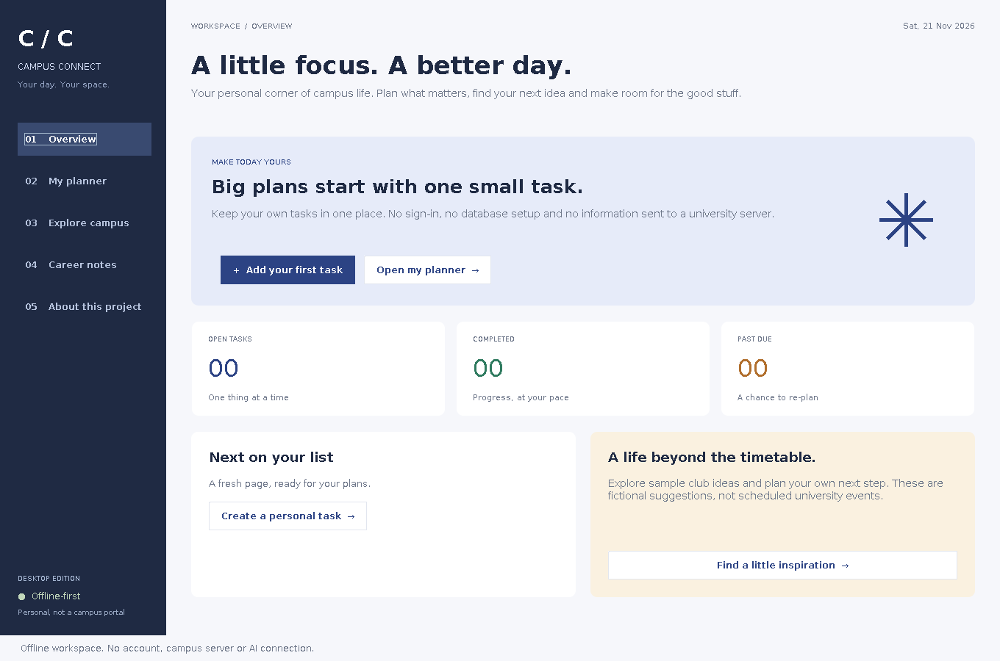
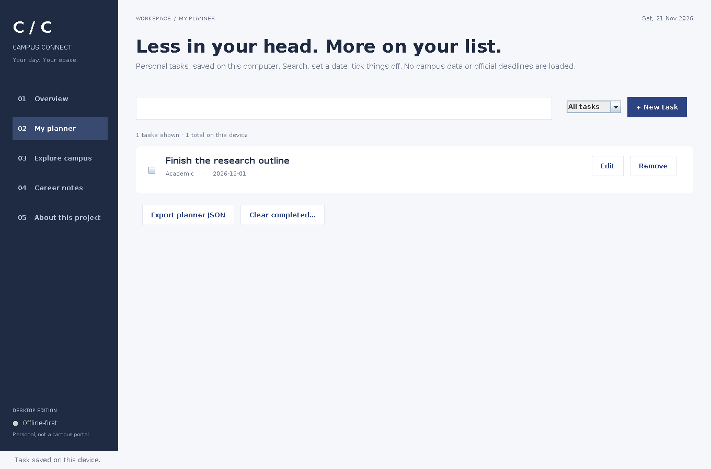
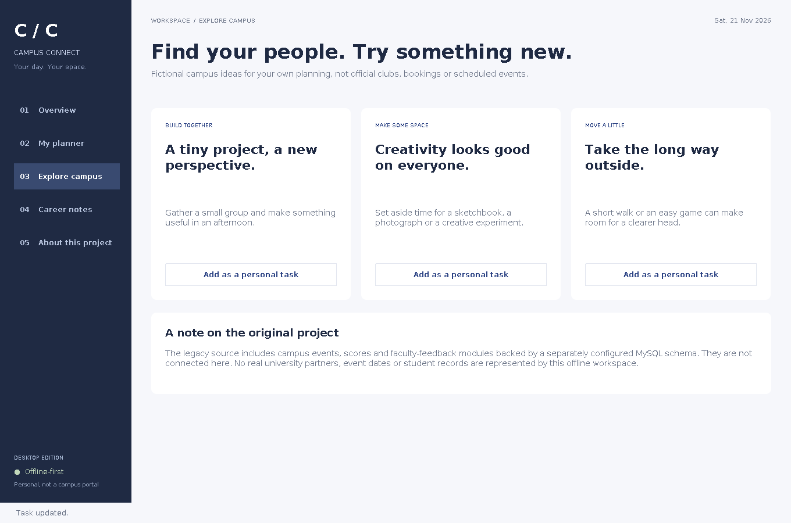

# Campus Connect

### A little focus. A better day.

An offline-first **Java Swing desktop workspace** for personal student planning. A calm navy-and-ivory interface, a planner that actually saves, and room to explore what comes next.

**This is a personal student project, not an official university portal.** The desktop app runs on your computer. Its web showcase contains screenshots and a downloadable Java application, not a browser version of Swing.



## Start in a minute

Install a **JDK 21 or later** and **Maven 3.9+**, then:

```sh
mvn clean verify
java -jar target/campus-connect-1.0.0.jar
```

No MySQL, account, API key or Internet connection is needed after dependencies have been downloaded. A graphical desktop is required; Java cannot open Swing windows in a headless terminal. The JAR works on Windows, macOS and Linux with a compatible Java installation. It is not a signed native installer.

## What works in this edition

- **Personal planner:** create and edit titles, notes, due dates and categories; mark tasks complete; remove tasks with confirmation.
- **Find your next step:** literal title/notes search, open/completed filters and due-date sorting.
- **Real local storage:** versioned JSON, atomic replacement where the filesystem supports it, a 1,000-task / 2 MB limit, and conflicting-window protection.
- **Backups:** export valid JSON. Export cannot overwrite the active planner file. Existing export files require confirmation.
- **Safer recovery:** malformed or unsupported saved data is left untouched. Work can continue in memory, with a persistent warning and export option. Close without exporting and that session-only work is lost.
- **Campus ideas and career reflections:** clearly fictional prompts that can become personal tasks. They are not registrations, official events or personalised career advice.
- **Keyboard-friendly Swing controls:** standard focus traversal, accessible field names and visible button focus.



Screenshots use synthetic tasks, not real student records. New installations start empty.

## Data and privacy

Default data file:

```text
~/.campus-connect/planner-v1.json
```

The file is **not encrypted**. Anyone with access to your operating-system account can read it. Do not store sensitive student, faculty or medical information. The offline workspace sends no network requests, telemetry or AI prompts. Export a backup before moving computers or clearing completed tasks.

If a second app window changes the file, saving from an older window is refused instead of silently overwriting newer work. Export any unsaved session and restart to load the latest file. The app has export, not an in-app import/merge feature. Restore only a trusted exported file with the app closed.

## Original campus modules are preserved

The original Java project includes login, homepage, task manager, events, feedback, submissions, career guidance, leaderboard and an optional Gemini client. These source modules remain available as **legacy, experimental database mode**, separate from the new offline planner.

```sh
# Use your own disposable development database. Keep credentials out of Git.
export CAMPUS_ENABLE_DATABASE=true
export CAMPUS_DB_URL='jdbc:mysql://localhost:3306/campus_connect?connectTimeout=5000&socketTimeout=10000'
export CAMPUS_DB_USER='your_local_development_user'
export CAMPUS_DB_PASSWORD='your_local_development_password'
java -jar target/campus-connect-1.0.0.jar --legacy-db
```

**Important limits before enabling legacy mode:**

- This repository does not provide a complete, tested migration/schema for all legacy modules. Inspect each module's SQL and supply an isolated compatible schema yourself. Legacy database workflows were compiled but **not end-to-end tested** against a live database.
- Direct desktop access to a shared database is not a secure multi-user architecture. Enrollment-number lookup is not an authorization boundary. Do not point these modules at a real university database or expose them as a public service.
- New login passwords use salted PBKDF2-HMAC-SHA256 hashes. Existing plaintext passwords are rejected. Back up your development schema, widen its password column to at least `VARCHAR(255)`, and recreate test accounts with the updated signup flow. No automatic migration or password recovery is included.
- Some original modules use synchronous database or AI work on the UI thread and need further refactoring for production use. The refreshed offline UI does not invoke them.
- The optional Gemini client requires your own `GEMINI_API_KEY`; an optional `GEMINI_MODEL` selects a model your account supports. It is not called by the offline workspace. Sending a prompt can disclose it to Google and may incur provider charges. No live AI calls were made during verification.
- Previously embedded API-key literals have been removed from the current source, **not Git history**. Their owner must revoke/rotate them. Removing text does not invalidate a key.

## Build, test and architecture

```text
src/com/ljuniversity/companion/
  Main.java                     offline launch, explicit legacy opt-in
  model/PlannerTask.java         validated immutable personal task
  ui/DesktopWorkspace.java      refreshed Swing workspace
  util/PlannerStore.java         bounded local JSON + export
  util/Passwords.java            versioned legacy password hashes
  util/AppConfig.java            environment-only database configuration
  ui/, model/, util/            preserved original project modules
src/resources/                  bundled original resources
 tests/                         synthetic JUnit regression tests
site/                           static desktop showcase, no student data
scripts/build-site.mjs           explicit showcase packaging
```

Java 21, Swing, Gson 2.13.2, MySQL Connector/J 9.5.0 and JUnit 5.14.1. Maven pins compiler, test and shaded-JAR packaging plugins. `mvn verify` builds the executable JAR and runs the synthetic tests. The original MIT license is retained.

The regression suite checks task validation, persistence, search/status filtering, stable edits, completion, deletion of completed tasks, corruption recovery, exports, conflicting writes, password verification, no-key AI behavior and leaderboard ordering. An additional graphical smoke check exercised the real new-task dialog, completion, search, navigation and prompt-to-task flows at desktop and minimum window sizes. Live MySQL, paid AI, multi-user security and native OS installers are outside these checks.



## Build the web showcase

```sh
mvn clean verify
node scripts/build-site.mjs
# Serve site-dist/ with any static host.
```

The build copies only the showcase HTML/CSS/JS, three synthetic screenshots and the built JAR. No database, local planner file or environment file is included. The download is Java bytecode, not a web app. Source history is preserved, with no force-push or rewrite.

## Credits

Created by Anjali Dubey as a Java campus-companion project. The original module structure and custom Swing components remain part of its learning history.
